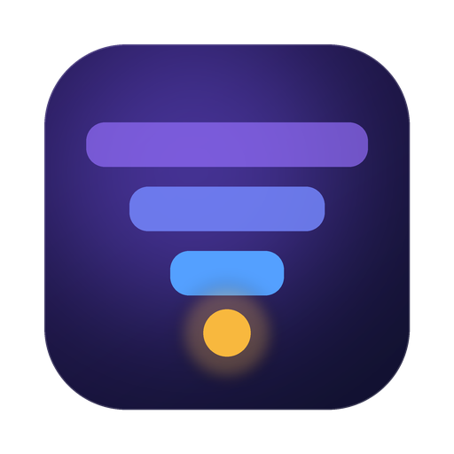
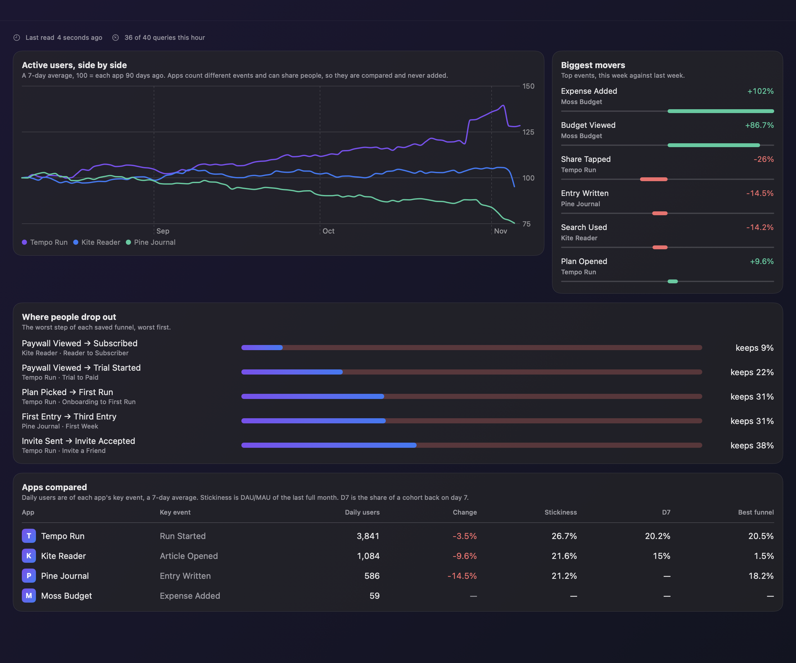
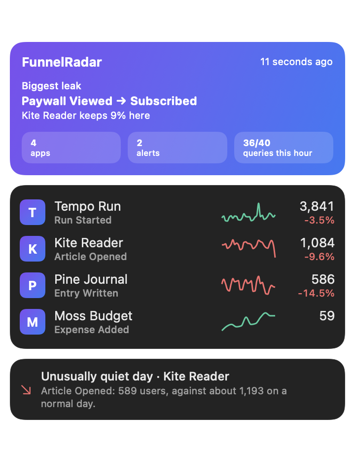
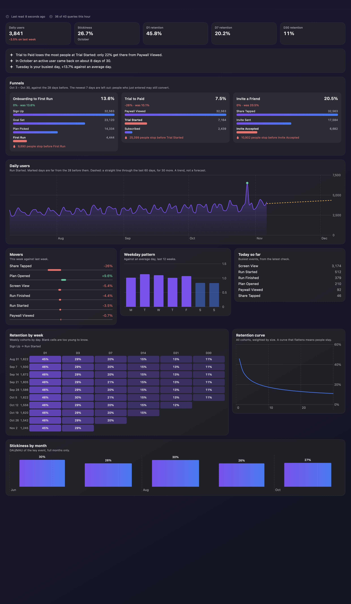

<p align="center"></p>

<h1 align="center">FunnelRadar</h1>

<p align="center">Your product analytics in the menu bar: funnel leaks, retention, stickiness and unusual days across all your Mixpanel projects.</p>

<p align="center"><a href="README.tr.md">Türkçe</a></p>

<p align="center"></p>

Mixpanel shows one project and one report at a time. FunnelRadar puts your projects side by side and answers the questions you'd otherwise click through panels for: where do people drop out, who comes back, and did anything strange happen yesterday? It is a free, open-source, native Mac app. It has no server and no account of its own.

> Screenshots use FunnelRadar's made-up demo apps. FunnelRadar is not affiliated with or endorsed by Mixpanel.

## Features

**Every project at once**
* Active users of each app as an index, so apps of any size can be compared. Numbers are never added across projects: apps count different events and can share people
* The biggest movers among your top events, this week against last week
* The leakiest funnel steps, worst first

**One project in depth**
* **Funnel leaks:** the worst step of up to three saved funnels, most recently changed first, and overall conversion against the period before
* **Retention:** D1, D7 and D30 from a pair of events you pick, with a cohort heatmap and a curve
* **Stickiness:** DAU/MAU of your key event, per full month
* **Unusual days:** days far from the 28 before them, with a weekday pattern and a trend line that is labelled as a trend

**Alerts**
* Falling conversion, unusually busy or quiet days, falling retention
* Notifications on your Mac with your own thresholds, each one once

<p align="center"></p>

<p align="center"></p>

## Install

Download the DMG from the [latest release](https://github.com/ardasnturk/funnelradar/releases/latest), or use Homebrew:

```sh
brew tap ardasnturk/funnelradar https://github.com/ardasnturk/funnelradar
brew install --cask funnelradar
```

FunnelRadar needs macOS 15 or newer and a Mixpanel account.

## Setup

FunnelRadar opens once these steps are done:

1. **The Mixpanel tool.** FunnelRadar reads your data through `mp`, Mixpanel's official open-source CLI ([mixpanel-headless](https://github.com/mixpanel/mixpanel-headless)). It installs a pinned version into its own folder, about 300 MB. That needs Python 3.10 or newer, which macOS doesn't ship: FunnelRadar uses `uv` if you have it, which can fetch Python by itself, then a `python3` you have, then Homebrew to get `uv`. Otherwise it tells you what to install.
2. **Sign in.** Your browser opens Mixpanel, and `mp` keeps the sign-in in FunnelRadar's folder, apart from any `mp` you use in a terminal. A service account works too; its secret stays in your Keychain and reaches `mp` through its environment.
3. **Your apps.** Pick the projects to follow.
4. **Notifications.** Optional.

If `mp` disappears or the sign-in expires, FunnelRadar returns to that step. Then pick each project's key event and retention events in Settings. Until you do, the busiest event stands in as the key event, and retention stays empty.

## How it works

Mixpanel's Query API allows 60 queries an hour and 5 at once, shared with everything else on the project. So FunnelRadar:

* never sends a query when you open a view
* checks each project every 2 hours, which costs one query
* reads the full reports once a day, because they are about days that have ended: about a dozen queries per app, with today left out
* sends one query at a time, spaced 5 seconds apart, and at most 40 an hour (10 or 20 if you prefer)
* backs off for 5 minutes to an hour on a 429, and counts queries across restarts
* keeps everything in `~/Library/Application Support/FunnelRadar`, in folders only you can read, and shows when it last read

The numbers follow each project's own time zone. Funnel periods stop 7 days before the last full day, because people who just entered may still convert and the newest days would always look worse.

FunnelRadar only reads. Its source protocol has no way to change anything in your account.

Your data goes between your Mac and Mixpanel, through `mp`. FunnelRadar has no analytics of its own and makes no other requests, apart from installing `mp` during setup. See [docs/DECISIONS.md](docs/DECISIONS.md).

## Remote Code

The hub lets [Remote Code](https://github.com/ardasnturk/remote-code) attach later. It listens on `127.0.0.1` only, and its token is in a `0600` file. See [docs/HUB_API.md](docs/HUB_API.md).

## Try it without an account

```sh
open -a FunnelRadar --args --demo
```

## Building from source

```sh
brew install xcodegen
xcodegen generate
open FunnelRadar.xcodeproj
```

Tests: `swift test --package-path FunnelKit`. Translations live in `scripts/l10n/source.py`; see [CONTRIBUTING.md](CONTRIBUTING.md).

## License

[MIT](LICENSE). Mixpanel is a trademark of its owner.
