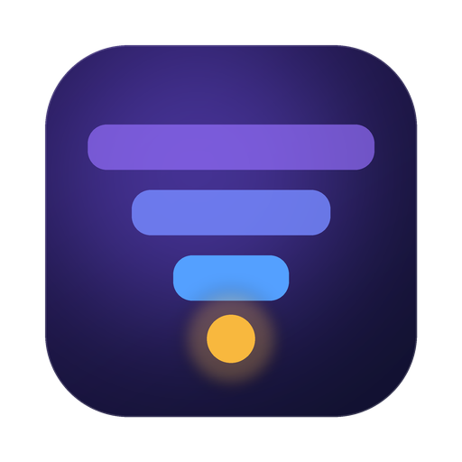
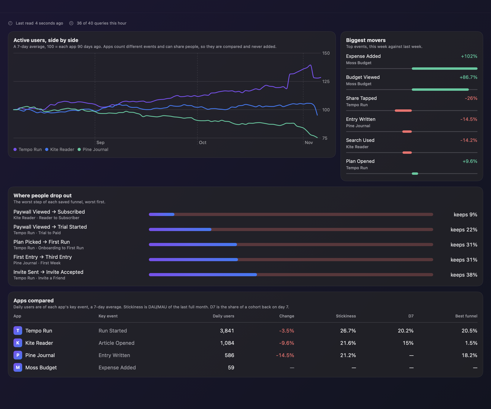

<p align="center"></p>

<h1 align="center">FunnelRadar</h1>

<p align="center">Ürün analitiğiniz menü çubuğunda: tüm Mixpanel projeleriniz için huni kayıpları, elde tutma, stickiness ve olağandışı günler.</p>

<p align="center"><a href="README.md">English</a></p>

<p align="center"></p>

Mixpanel projeleri ve raporları tek tek gösterir. FunnelRadar projelerinizi yan yana koyar ve panellerde tıklayarak aradığınız soruları yanıtlar: insanlar nerede dökülüyor, kim geri geliyor, dün garip bir şey oldu mu? Ücretsiz, açık kaynaklı ve native bir Mac uygulamasıdır; sunucusu ve kendi hesabı yoktur.

> Görseller FunnelRadar'ın uydurma demo uygulamalarıyla alınmıştır. FunnelRadar'ın Mixpanel ile bir bağlantısı yoktur.

## Özellikler

* Uygulamaların aktif kullanıcıları endeks olarak yan yana. Rakamlar projeler arasında toplanmaz: uygulamalar farklı olayları sayar, kullanıcıları ortak olabilir
* En çok değişen olaylar, bu hafta geçen haftaya göre
* Kayıtlı hunilerin en kötü adımı ve bir önceki döneme göre dönüşüm (proje başına en çok 3 huni)
* Seçtiğiniz iki olaydan D1, D7, D30 elde tutma, kohort ısı haritası ve eğri
* Stickiness (DAU/MAU), olağandışı günler, hafta günü deseni ve eğilim çizgisi
* Düşen dönüşüm, olağandışı günler ve düşen elde tutma için kendi eşiklerinizle Mac bildirimleri

## Kurulum

DMG'yi [son sürümden](https://github.com/ardasnturk/funnelradar/releases/latest) indirin ya da Homebrew kullanın:

```sh
brew tap ardasnturk/funnelradar https://github.com/ardasnturk/funnelradar
brew install --cask funnelradar
```

macOS 15 veya üstü ve bir Mixpanel hesabı gerekir. Uygulama şu adımlardan sonra açılır:

1. **Mixpanel aracı:** FunnelRadar, Mixpanel'in resmi `mp` aracının sabit bir sürümünü kendi klasörüne kurar (yaklaşık 300 MB). Python 3.10 gerekir: `uv` varsa onu, yoksa mevcut `python3`'ü, o da yoksa Homebrew ile `uv` kullanır.
2. **Giriş:** tarayıcıda Mixpanel açılır, girişi `mp` saklar; terminalde kullandığınız `mp`'den ayrıdır. İsterseniz service account kullanabilirsiniz; gizli anahtar Anahtar Zinciri'nde tutulur.
3. **Uygulamalar:** izlenecek projeleri seçersiniz.
4. **Bildirimler:** isteğe bağlıdır.

Mixpanel Query API saatte 60 sorguya izin verir, bu sınır projenin diğer araçlarıyla ortaktır. FunnelRadar görünüm açıldığında sorgu göndermez, projeyi 2 saatte bir tek sorguyla kontrol eder, tam raporları günde bir kez okur ve saatte en çok 40 sorgu kullanır. Yalnızca okur; hesabınızda hiçbir şeyi değiştiremez. Verileriniz yalnızca Mac'iniz ile Mixpanel arasında dolaşır.

## Lisans

[MIT](LICENSE). Mixpanel, sahibinin ticari markasıdır.
